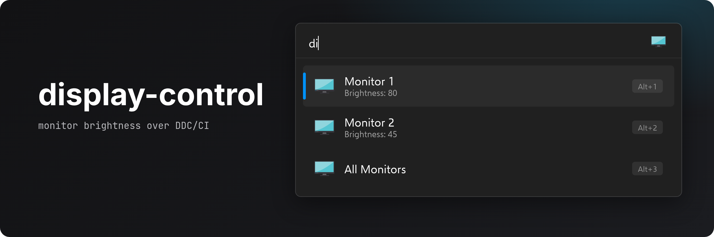

<!-- generated by readwright from docs/README.md.j2; edit the template, not this file -->


# Display Control

Set the brightness of your monitors from Flow Launcher over DDC/CI.

[](https://github.com/Garulf/Display-Control/actions/workflows/tests.yml) [](https://github.com/Garulf/Display-Control/releases/latest) [](https://github.com/Garulf/Display-Control/releases/latest)

[](https://www.buymeacoffee.com/garulf) [](https://github.com/sponsors/Garulf)

## Features

* **Every monitor at a glance.** Each connected monitor is listed with its current brightness.
* **Quick brightness steps.** Set 100%, 75%, 50%, 25% or 0% from the context menu.
* **All monitors at once.** With more than one monitor, **All Monitors** sets them together.
* **No vendor tools.** Talks to your monitors directly over DDC/CI.

## Usage

Type `di` to list your monitors:

```
di
```


Add a number to pick one monitor, for example `di 2`.

### Set the brightness

Open the context menu on a monitor or on **All Monitors** (`Shift+Enter` or right-click) and pick a level:


A monitor that does not answer DDC/CI, such as most laptop panels, shows its brightness as unavailable.
Turn on DDC/CI in your monitor's on-screen menu if it is off.

## Installation

Display Control is not in the Flow Launcher plugin store. Download `Display-Control-<version>.zip` from the
[latest release](https://github.com/Garulf/Display-Control/releases/latest) and unzip it into `%appdata%\FlowLauncher\Plugins`, then restart
Flow Launcher.

Pre-releases of the next version are published from the open release PR on the
[releases page](https://github.com/Garulf/Display-Control/releases) for testing. Flow Launcher won't offer them as updates.

## Requirements

* Windows, with monitors that support DDC/CI
* Flow Launcher 1.17.0 or newer
* Python 3.8 or newer, which Flow Launcher can install for you
